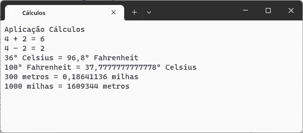

# Cálculos :1234:

Aplicação em C# para efetuar diversos tipos de Calculo Matemático

Desenvolvida no âmbito da Formação **Introdução ao Git/GitHub**

## Operações Suportadas

Esta Aplicação implementa as seguintes operações:

- Soma
- Subtração
- Conversão de Temperaturas
	- Celsius :arrow_right: Fahrenheit
	- Fahrenheit :arrow_right: Celsius
- Conversão de Distâncias
	- Metros :arrow_right: Milhas
	- Milhas :arrow_right: Metros
	
## Tecnologias utilizadas neste projeto

- **Visual Studio**
- C#
- Git
- GitHub Desktop
